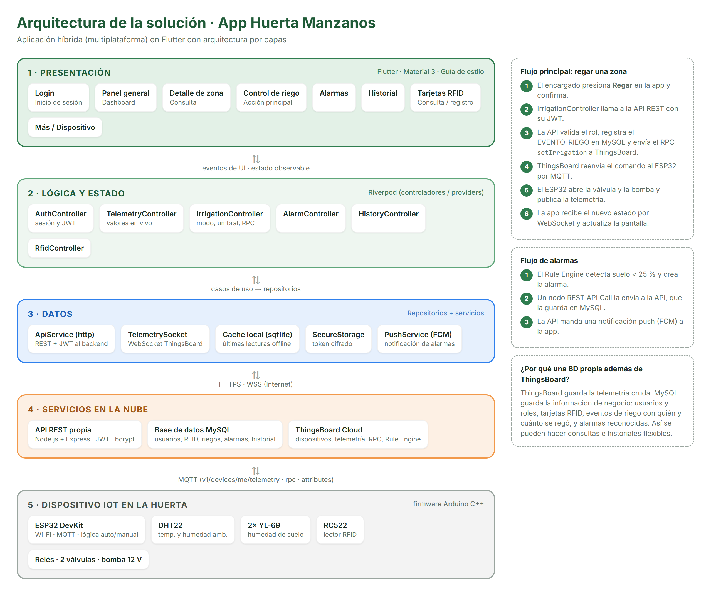

# Huerta Manzanos · App móvil de riego IoT

App móvil del proyecto **Sistema IoT para Monitoreo y Control de Riego en Huertas de Manzana** (Instituto Tecnológico de Ciudad Cuauhtémoc, 9° "B", Ingeniería en Sistemas Computacionales).

Con la app, el encargado de la huerta consulta en tiempo real la humedad de suelo de cada zona, la temperatura y la humedad ambiente. También puede regar o detener cada zona, cambiar entre modo automático y manual, atender las alarmas del Rule Engine de ThingsBoard y administrar las tarjetas RFID de los encargados.

**Equipo:** Axel Holguín Marrufo · Daniel Varela Legarreta · Reyes Fernando Zubía Arias

## Prototipo navegable

👉 **https://TU-USUARIO.github.io/riego-huerta-app/**

- Versión en baja fidelidad (wireframes): agrega `?modo=wireframe` a la dirección.
- Se ve en un marco de teléfono en la computadora y en pantalla completa en el celular.

## Fase actual: arquitectura, modelo de datos y UI/UX

| Entregable | Archivo |
|---|---|
| Documento de arquitectura | [`docs/Documento_Arquitectura.pdf`](docs/Documento_Arquitectura.pdf) |
| Guía de estilo | [`docs/Guia_de_Estilo.pdf`](docs/Guia_de_Estilo.pdf) |
| Diagrama ER | [`docs/diagrama_ER.png`](docs/diagrama_ER.png) |
| Diagrama de arquitectura | [`docs/diagrama_arquitectura.png`](docs/diagrama_arquitectura.png) |
| Script MySQL del modelo | [`docs/modelo_datos.sql`](docs/modelo_datos.sql) |
| Prototipo (fuente) | [`design/prototipo/index.html`](design/prototipo/index.html) |
| Wireframes | [`design/wireframes/`](design/wireframes/) |
| Capturas del prototipo | [`design/capturas-prototipo/`](design/capturas-prototipo/) |
| Mapa de navegación | [`design/diagramas/mapa_navegacion.png`](design/diagramas/mapa_navegacion.png) |

## Arquitectura

App **híbrida (multiplataforma) en Flutter**, organizada en capas:

1. **Presentación:** pantallas de Flutter con Material 3.
2. **Lógica y estado:** Riverpod.
3. **Datos:** http, WebSocket, sqflite y secure storage.
4. **Servicios en la nube:** API REST en Node.js + MySQL, y ThingsBoard Cloud.
5. **Dispositivo IoT:** ESP32 con DHT22, YL-69, RC522, electroválvulas y bomba, conectado por MQTT.



## Regenerar las capturas

Requiere Microsoft Edge (Windows):

```powershell
powershell -ExecutionPolicy Bypass -File design\capturar.ps1
```
